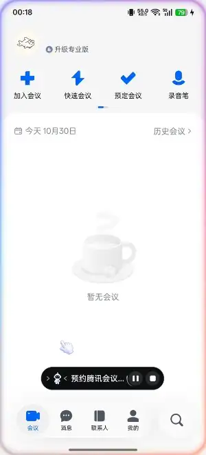
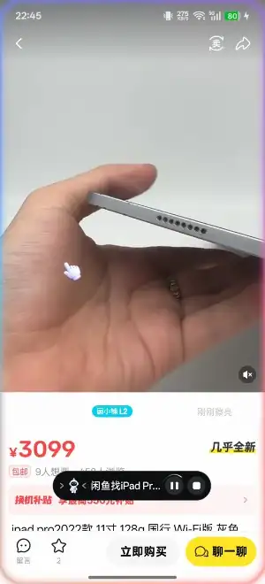
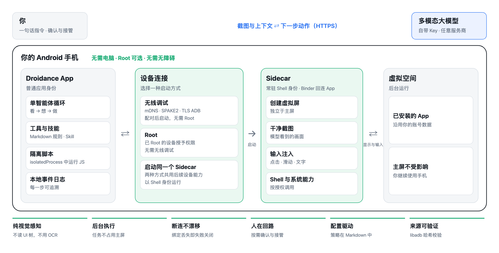

<div align="center">


# Droidance Fork — Android AI Agent with Terminal, Browser & JVM

**Base:** [ybblab/Droidance](https://github.com/ybblab/Droidance) v0.3.1  
**License:** Apache-2.0

---

## 🎯 Yeni Özellikler (Fork Eklentileri)

| Özellik | Açıklama | Durum |
|---------|----------|-------|
| **🖥️ Gömülü Termux Terminal** | Tam donanımlı `apt`, `pkg`, Python/Node/Git, script çalıştırma, dosya indirme | ✅ Implementasyon tamamlandı |
| **🌐 Gömülü Tarayıcı (CDP)** | Chrome DevTools Protocol ile DOM erişimi, tıklama, yazma, screenshot, iframe, JS eval | ✅ Implementasyon tamamlandı |
| **☕ Gömülü JVM/Gradle** | `kotlinc` derleme, `gradle` build, Kotlin/Java kod çalıştırma (Termux JDK veya embedded) | ✅ Implementasyon tamamlandı |

---

## 🏗️ Mimarî Genel Bakış (Fork)

```
┌─────────────────────────────────────────────────────────────────────┐
│                         Droidance Fork                              │
├─────────────────────────────────────────────────────────────────────┤
│  Agent Loop (core:agent)                                            │
│    ├── ToolExecutor → DeviceToolNames.{ANDROID_READ, ANDROID_ACT,  │
│    │   SHELL, SCREEN_ACT, BROWSER_ACT, TERMUX_ACT, JVM_ACT,        │
│    │   WORKSPACE}                                                   │
│    └── ToolRiskPolicy (harness_policy.yaml)                         │
├─────────────────────────────────────────────────────────────────────┤
│  core:device                                                          │
│    ├── VirtualSpaceSidecarService (shell uid=2000)                  │
│    │   ├── VirtualDisplay + ImageReader + injectInputEvent          │
│    │   └── Supervisor (auto-restart)                                │
│    ├── BrowserManager + BrowserCdpClient (WebView + CDP)            │
│    │   ├── navigate, click, type, screenshot, eval_js, get_dom     │
│    │   └── Profile/cookie isolation                                 │
│    ├── TermuxBootstrapManager + ProotLauncher                       │
│    │   ├── bootstrap-aarch64.zip (assets) → PRoot mount             │
│    │   ├── apt/pkg/pkg install, session management                  │
│    │   └── File bridge (host ↔ Termux)                              │
│    └── JvmEmbeddedManager (optional embedded or Termux JDK)         │
│        ├── kotlinc compile & run                                    │
│        └── gradle wrapper build                                     │
└─────────────────────────────────────────────────────────────────────┘
```

---

## 📖 Orijinal Droidance Dokümantasyonu (Türkçe/中文)

**Droidance 是一个运行在安卓手机上的开源 AI 智能体。** 你只需要说一句话，它就会像人一样「看屏幕、想下一步、动手点」，在 App 里替你把事情做完：比价、点单、查询、预约、整理信息、定时执行……

Droidance **只靠一个多模态大模型 API Key 就能跑起来**：不用 Root，不用连电脑，也不用开无障碍服务。任务在手机的**虚拟空间**里后台执行，你照常聊天、刷视频、接电话，它在另一块"看不见的屏幕"上安静干活。它**依靠截图理解界面**，不读取 UI 层级、不依赖无障碍树，人能看懂的界面，它就能尝试操作。

### 核心特性

| | | |
| :--- | :---: | :---: |
| 🔑 **一个 Key 就能用** | 🌌 **后台执行，不打扰你** | 👁️ **纯视觉驱动** |
| 不需要 Root、电脑、数据线或额外硬件。装好 App，完成无线调试配对，填一个多模态大模型的 API Key，就能开始下达任务。 | 任务运行在独立的虚拟空间里，不占用主屏幕。你用你的手机，它干它的活；需要时也能随时切过去围观或接手。 | 不 Dump XML 层级，不使用无障碍服务。自绘控件、WebView 等无障碍树不完整的界面，也能像人一样看着屏幕操作。 |

---

## 📲 下载与上手

**准备：**

- 一部 Android 11 及以上的手机。低内存设备和 Android Go 不支持。
- 无线调试连接无需 Root，配对时需要 Wi‑Fi；Root 连接需要设备已 Root 并授予 Droidance Root 权限。模型服务仍需要可用的网络连接。
- Android 11–13 为实验性支持：系统没有虚拟屏独立焦点，按键和文字输入时会短暂占用主屏焦点；Android 11、12 锁屏后任务无法继续。
- 如果 Agent 提示系统拦截输入，小米系请在开发者选项开启"USB 调试（安全设置）"，OPPO、一加、realme 请关闭"权限监控"，然后重新连接设备。
- 一个支持图像输入和工具调用的多模态大模型 API Key。

| 步骤 | 操作 |
| :---: | :--- |
| **1** | 前往 [Releases](https://github.com/YbbLab/Droidance/releases/latest) 下载最新 APK 并安装 |
| **2** | 在「连接设备」选择无线调试，按引导打开「开发者选项 → 无线调试」并输入配对码；已 Root 的设备也可以选择 Root 并授权；已启动 Shizuku 的用户可选择 Shizuku 并允许授权。**全程不需要电脑** |
| **3** | 添加模型服务商的服务地址、API Key 和模型，用一句话说出你的任务 |

完成。任务会在后台执行，你可以通过顶部的运行岛随时查看进度、暂停或接手操作。

> [!NOTE]
> 从 v0.1.9 起支持 Root 连接。项目仍处于预览阶段，变更记录见 [CHANGELOG](CHANGELOG.md)。每个 Release 都附带 APK 的 `.sha256` 校验文件，安装前可以核对。

> [!CAUTION]
> 本项目仅供学习与研究使用。自动化操作可能违反部分 App 的服务条款，存在账号受限的风险。使用前请阅读[免责声明](#免责声明)。

<details>
<summary><b>从源码构建</b></summary>

需要 JDK 17 与 Android SDK 35。在仓库根目录的 `local.properties` 中配置 `sdk.dir`（该文件已被 Git 忽略），然后：

```bash
git clone https://github.com/YbbLab/Droidance.git
cd Droidance
./gradlew :app:assembleDebug
```

选择内置服务商，填写 API 密钥和模型 ID 后保存即可启用。API 地址和协议已预填，不预置模型 ID；也可以添加自定义地址。已有配置会保留。构建过程不会将本机 Key 注入 APK。

公开源码检查（架构、资源、原生依赖、Lint 与 Debug APK；本地保留测试时也会运行测试）：

```bash
scripts/verify.sh
```

开发约定与验证方式见 [CONTRIBUTING](CONTRIBUTING.md)。

</details>

---

## ✨ 能做什么

<table>
<tr>
<td width="33%" align="center" valign="top"><a href="assets/demos/compare.mp4"></a><br /><b>跨平台比价</b><br /><sub>比较拼多多、天猫旗舰店和京东自营的 iPhone 到手价</sub></td>
<td width="33%" align="center" valign="top"><a href="assets/demos/tea.mp4"></a><br /><b>点奶茶</b><br /><sub>选好规格和红包，停在提交订单页等你确认</sub></td>
<td width="33%" align="center" valign="top"><a href="assets/demos/meeting.mp4"></a><br /><b>预约并分享会议</b><br /><sub>预约腾讯会议，把会议信息发到微信文件传输助手</sub></td>
</tr>
<tr>
<td width="33%" align="center" valign="top"><a href="assets/demos/train.mp4"></a><br /><b>查高铁</b><br /><sub>筛选后天上午有二等座的车次，整理时间和票价</sub></td>
<td width="33%" align="center" valign="top"><a href="assets/demos/resale.mp4"></a><br /><b>二手询价</b><br /><sub>在闲鱼挑 3 台 iPad，礼貌询问电池和维修情况</sub></td>
<td width="33%" align="center" valign="top"><a href="assets/demos/review.mp4"></a><br /><b>商品评价</b><br /><sub>在京东完成待评价商品的评分和提交</sub></td>
</tr>
</table>

<sub>示例经过剪辑，部分操作经过倍速处理，隐私信息已遮挡。点击动图查看完整视频。</sub>

**更多能力**

- **人在回路**：人机验证（CAPTCHA）始终由你完成；遇到支付、密码、登录授权等需要你本人决定的步骤，智能体会暂停并请你接手。你也可以随时接管，操作完再交还给它。
- **定时任务**：支持一次性、每日/每周与固定间隔的计划，到点自动执行。
- **技能沉淀**：把摸索出的有效流程沉淀为可复用的技能（Skill），之后按需加载，越用越顺手。
- **系统能力**：在你授权后，可以直接读写日历、联系人、短信等系统数据，不必每一步都操作界面。
- **模型自由**：可接入支持图像输入与工具调用的 OpenAI 兼容端点，服务地址、API Key 和模型都由你自己配置。

**和常见方案对比**

| | 电脑端 ADB 控制方案 | 基于无障碍服务的 Agent | **Droidance** |
| :--- | :---: | :---: | :---: |
| 不需要电脑 / USB | ❌ | ✅ | ✅ |
| 不需要 Root | ✅ | ✅ | ✅ |
| 不依赖 UI 层级 / 无障碍服务 | ⚠️ 取决于实现 | ❌ | ✅ |
| 执行时不占用主屏 | ❌ | ❌ | ✅ |
| 敏感步骤暂停、人工接管 | ⚠️ | ⚠️ | ✅ |

---

## 🏗️ 技术架构与运行机制

<picture>
  <source media="(prefers-color-scheme: dark)" srcset="assets/architecture/architecture-zh-dark.png" />
  
</picture>

### 它是怎么在安卓手机上跑起来的

1. **内置 ADB，手机自己连自己**：App 内置完整的无线调试客户端：用 mDNS 发现本机端口，用 `libadb.so`（BoringSSL）完成 SPAKE2 配对，再由 Kotlin 实现的 TLS ADB 客户端以本地 RSA 密钥连接系统 `adbd`，启动常驻的 Shell 身份执行进程（Sidecar）。不需要 Root，也不需要电脑。已 Root 的设备也可以授权 App 通过 Root 启动同一个 Sidecar，无需无线调试。
2. **创建虚拟空间**：Sidecar 在手机上创建一块独立的虚拟显示屏。App 在这块屏幕上打开，使用的是你手机上已安装的应用和已登录的账号，不是另一份数据拷贝。
3. **纯视觉感知**：智能体只读取虚拟屏的截图，必要时局部放大查看细节。不读取 UI 层级、不使用无障碍服务，也不依赖本地 OCR 模型。
4. **单一智能体决策**：同一个智能体根据画面和上下文，自主选择直接回答、调用系统能力（日历、短信、通讯录等）、执行隔离脚本，还是进行界面操作。没有额外的意图分类器或规划器，一个循环走到底。
5. **执行与回报**：点击、输入、滑动都发往同一块虚拟屏。每一步执行后重新观察画面，确认效果再决定下一步；执行过程完整记录在本地，任务结束后把结果回报给你（App 内与本地通知）。

### 模块组成

| 模块 | 职责 |
| --- | --- |
| `app` | 安卓宿主、界面、设置与运行时服务 |
| `core:agent` | 智能体决策循环、任务生命周期、工具协议与上下文管理 |
| `core:model` | 模型抽象层、各服务商适配与流式协议 |
| `core:device` | Sidecar、截屏、输入、系统能力与隔离脚本执行 |
| `core:knowledge` | 技能、记忆与文档存储 |
| `core:persistence` | 事件与知识的本地持久化 |

智能体的规则与策略放在 Markdown 配置中（`app/src/main/assets/rules/`、`skills/`），Kotlin 只负责通用编排、协议校验、设备执行与持久化。

---

## 🔒 隐私与安全

**数据去向**

- **本地优先**：会话、技能与执行记录只保存在你的设备上，没有任何第三方统计或遥测。
- **模型请求**：指令、上下文与截图直接发送给**你配置的模型服务商**，不经过 Droidance 服务器。请查阅该服务商的隐私政策。
- **你的凭证**：API Key 存储在应用私有存储中，运行时在内存中传给 Shell 身份的运行环境。运行时数据与历史位于设备上的 Shell 所有目录，卸载 App **不会**自动清除；旧版本卸载后残留的目录可能仍保留凭证副本。新版本运行时会清理当前安装的副本，但不会清理早期版本留下的目录。见 [SECURITY](SECURITY.md)。
- **本地诊断**：App 自动保留模型请求、响应与截图用于排查问题；这些可能仍包含个人信息。清理目标为 7 天与 512 MiB，但以"尽力而为"方式在后续请求时运行，不包含当前任务，所以二者均非严格保留上限。可在设置 → 数据管理 → 清理运行日志中手动清理；会话、回放附件与记忆单独管理。诊断导出可能含敏感内容，分享前请核对。
- **应用更新**：更新检查访问 GitHub API。直接下载失败时回退到 `ghproxy.net` 镜像；包校验和始终来自 GitHub API。

**权限**

| 权限 / 能力 | 用途 |
| --- | --- |
| 无线调试配对 | 无 Root 启动 Shell 身份的设备控制进程 |
| Root 访问（可选） | 无需无线调试启动同一设备控制进程 |
| Shizuku 授权（可选） | 通过运行中的 Shizuku 服务启动同一设备控制进程 |
| 日历、联系人、短信、通话记录 | 智能体在任务中经授权后可用的系统能力 |
| 通知访问 | 读取通知用于任务与自动化 |
| Droidance 键盘 | 在虚拟屏上输入文本 |
| 查询已安装应用 | 按名称查找并启动目标应用 |
| 精确闹钟、开机自启、电池优化豁免 | 准时运行与恢复定时任务 |
| 安装未知应用 | App 内安装下载的更新 |

运行时权限可随时在系统设置撤销。无线配对后 Sidecar 不再依赖 Wi‑Fi，被杀后会自动重启；关闭开发者选项后不再重启。App 更新后 Sidecar 必须替换；若无法自动重连，重新开启无线调试或在 Root 设备上使用 Root 连接。Root 模式使用 Root 权限启动并恢复通道；撤销授权后新启动或恢复会失败。安全问题请按 [SECURITY](SECURITY.md) 私下报告。

**限制**

- **人工确认**：智能体根据规则决定何时暂停，这不是硬性拦截。涉及资金、隐私或不可逆操作时，请让它停在确认页，由你复核提交。
- **非侵入式**：不对第三方 App 做 Hook、注入或修改。

---

## 📱 兼容性与已知限制

- 无线配对与重启后重连需要 Wi‑Fi。部分系统会在网络变更、重启或长时间闲置后关闭无线调试，需要时再开启。
- Shizuku 需单独安装并通过 ADB 或无线调试启动；重启后需再次启动。Root 启动的 Shizuku 请选择 Droidance 的 Root 连接。已建立的设备通道在 Shizuku 服务停止后仍可用。
- Root 连接已在 Android 16 实体机 + SukiSU 上测试通过；其他 Root 管理器与设备表现可能不同。
- 部分厂商系统限制后台工作。请允许 Droidance 后台运行并关闭其电池优化。
- 部分应用检测开发者选项或无线调试并拒绝运行或限制功能。
- 成功率与速度取决于模型的视觉与推理能力。智能体报告"完成"不代表业务结果正确，重要结果请自行核实。

---

## 🚀 Fork Eklentileri Kullanım Kılavuzu

### 🖥️ Termux Terminal (`termux_act`)
```json
{"op": "ensure_ready"}                                    // Bootstrap indir/doğrula
{"op": "exec", "command": "apt update && apt install -y python3 git", "timeout_ms": 180000}
{"op": "install", "package_name": "nodejs-lts"}
{"op": "session_start", "command": "python3 -m http.server 8080"}
```

### 🌐 Gömülü Tarayıcı (`browser_act`)
```json
{"op": "create_profile", "profile_name": "github", "viewport_width": 1280}
{"op": "launch", "profile_id": "profile_1"}               // webview_id döner
{"op": "navigate", "webview_id": 1, "url": "https://github.com/trending"}
{"op": "click", "webview_id": 1, "selector": "article.Box-row h2 a"}
{"op": "get_dom", "webview_id": 1, "selector": "article.Box-row"}
{"op": "eval_js", "webview_id": 1, "expression": "document.querySelectorAll('article').length"}
{"op": "screenshot", "webview_id": 1, "format": "png"}
```

### ☕ JVM/Kotlin (`jvm_act`)
```json
{"op": "compile_run", "source_code": "fun main() { println(\"Merhaba from Kotlin!\") }"}
{"op": "gradle_build", "project_dir": "/data/data/com.droidance.fork/files/workspace/my-project", "tasks": ["build", "test"]}
```

---

## 🛠️ Geliştirme Ortamı

### GitHub Codespaces (Önerilen)
1. Repository → **Code** → **Codespaces** → **Create codespace on main**
2. Otomatik olarak Android SDK, Emulator, Termux bootstrap hazırlanır
3. Terminalde:
   ```bash
   ./gradlew :app:assembleDebug
   # Emulator başlat:
   emulator -avd droidance_test -no-window -no-audio -no-boot-anim -gpu swiftshader_indirect &
   ./gradlew connectedDebugAndroidTest
   ```

### Local Docker
```bash
docker run --rm -it \
  -v "$PWD":/work -w /work \
  --device=/dev/kvm \
  --cap-add=SYS_ADMIN --cap-add=CAP_DAC_OVERRIDE \
  --security-opt=seccomp=unconfined \
  mcr.microsoft.com/devcontainers/android:1-35 bash

# İçeride:
./gradlew :app:assembleDebug
```

### CI/CD (GitHub Actions)
- **Push/PR:** Static analysis (detekt, lint), Unit test, Instrumented test (emulator), Debug APK build
- **Tag push:** Release APK build, sign, GitHub Release draft
- **Workflow dosyaları:** `.github/workflows/ci.yml`, `release.yml`

---

## 📦 APK Boyutu

| Yapılandırma | Tahmini Boyut |
|--------------|---------------|
| Base Droidance | ~13 MB |
| + Termux Bootstrap (assets) | +8 MB |
| + Embedded JVM (opsiyonel, "Geek Mode") | +20 MB |
| **Toplam (Standart)** | **~21 MB** |
| **Toplam (Geek Mode)** | **~41 MB** |

> Termux bootstrap APK içinde `assets/termux/bootstrap-aarch64.zip` olarak saklanır, ilk kullanımda PRoot'ta açılır.

---

## 🔐 Güvenlik Modeli (Fork Genişletmesi)

| Bileşen | İzolasyon | Yetki |
|---------|-----------|-------|
| **Sidecar (shell uid=2000)** | AIDL + Binder + `linkToDeath` | VirtualDisplay, input injection, `am start --display` |
| **Termux (PRoot)** | Mount namespace, seccomp | `apt`, `pkg`, kendi rootfs, network (CleartextNetworkPolicy) |
| **Browser (WebView)** | Sanal ekranda gizli, CDP localhost | HTTP(S), DOM, JS, cookie/profile isolation |
| **JVM** | Termux içinde veya embedded | `kotlinc`, `gradle`, `java` |
| **Agent (app UID)** | ToolRiskPolicy + HighRiskConfirmationStore | Orchestration, model API |

**Yeni Onay Gerektiren Araçlar (60 sn):**
- `browser_act` — Navigasyon, tıklama, yazma
- `termux_act` — `apt install`, script çalıştırma
- `jvm_act` — Derleme, gradle build

**Shell Yasak Kalıplar (genişletildi):**
- `proot --mount`, `chroot`, `nsenter` — escape denemeleri
- `apt remove/purge`, `pkg uninstall` — sistem paket kaldırma

---

## 🧪 Test

```bash
# Unit testler (Robolectric)
./gradlew testDebugUnitTest

# Entegrasyon testleri (Emulator API 35 ARM64 gerekli)
./gradlew connectedDebugAndroidTest

# Static analysis
./gradlew detekt :app:lintDebug verifyArchitecture

# Termux bootstrap doğrulama
python3 scripts/verify_termux.py
```

---

## 📚 Belge İçi Referanslar

- [FORK_DESIGN.md](FORK_DESIGN.md) — Detaylı teknik tasarım, milestones, riskler
- [app/src/main/assets/rules/harness_policy.yaml](app/src/main/assets/rules/harness_policy.yaml) — Güvenlik politikası
- [core/device/src/main/java/com/droidance/core/device/termux/](core/device/src/main/java/com/droidance/core/device/termux/) — Termux modülü
- [core/device/src/main/java/com/droidance/core/device/browser/](core/device/src/main/java/com/droidance/core/device/browser/) — Browser modülü
- [core/device/src/main/java/com/droidance/core/device/jvm/](core/device/src/main/java/com/droidance/core/device/jvm/) — JVM modülü

---

## 🤝 Katkı

1. Fork → Feature branch → PR
2. `./gradlew detekt testDebugUnitTest connectedDebugAndroidTest` yeşil olmalı
3. `harness_policy.yaml` güncellemesi gerekiyorsa güvenlik incelemesi istenir
4. Yeni araç eklendiğinde `DeviceToolNames` + `ToolRiskPolicy` + `harness_policy.yaml` güncellenmeli

---

## ⚖️ Lisans

Apache-2.0 — Orijinal Droidance lisansı korunur. Değişiklikler `@author` etiketi ile işaretlenir.

---

## 🙏 Teşekkürler

- [ybblab/Droidance](https://github.com/ybblab/Droidance) — Harika temel proje
- [Termux](https://termux.dev/) — PRoot bootstrap ve paketler
- [Chrome DevTools Protocol](https://chromedevtools.github.io/devtools-protocol/) — Browser otomasyon standardı